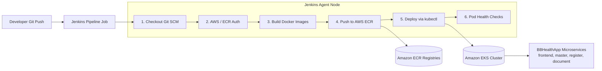

# BBHealthApp - Jenkins CI/CD Deployment to EKS Guide (Pure Manifests - No Helm)

This guide walks you through setting up Jenkins for Continuous Integration and Continuous Deployment (CI/CD) to deploy **BBHealthApp** to an AWS EKS cluster using native Kubernetes manifests and `kubectl` (**No Helm required**).

---

## Architecture Overview



---

## Prerequisites

### 1. Existing EKS Cluster
- EKS cluster should already be provisioned and in `ACTIVE` state (e.g. from Terraform `bbhealthapp-dev`).
- Worker node groups (EC2 instances) must be running and joined to the cluster.

### 2. Jenkins Server
- Jenkins installed (EC2 instance, on-premises, or cloud).
- Jenkins version 2.x or higher with Administrative access.

### 3. Required Software on Jenkins Agent
- **AWS CLI (v2)** - For AWS authentication and STS commands
- **Docker** - For container image building and registry push
- **kubectl** - For native Kubernetes orchestration (`apply`, `set image`, `rollout`)
- **Git** - For cloning the source code
*(Note: Helm is NOT needed)*

### 4. AWS Credentials & IAM Permissions
- AWS Access Key ID and Secret Access Key
- IAM user/role with permissions for:
  - **EKS**: `eks:DescribeCluster`, `eks:ListClusters`, and Kubernetes RBAC cluster access (`aws-auth` / Access Entries)
  - **ECR**: `ecr:GetAuthorizationToken`, `ecr:BatchCheckLayerAvailability`, `ecr:GetDownloadUrlForLayer`, `ecr:PutImage`, `ecr:InitiateLayerUpload`, `ecr:UploadLayerPart`, `ecr:CompleteLayerUpload`
  - **STS**: `sts:GetCallerIdentity`

### 5. Source Code Repository
- Repository containing `bbhealthapp-backend`, `bbhealthapp-frontend`, and `k8s/` manifests.

---

## Jenkins Setup

### Step 1: Install Required Jenkins Plugins

1. Navigate to **Manage Jenkins** → **Plugins** → **Available plugins**.
2. Search and select:
   - **Pipeline** (Pipeline suite)
   - **Git Plugin**
   - **Docker Pipeline**
   - **AWS Steps** (or **Pipeline: AWS Steps**)
   - **Credentials Binding Plugin**
   - **Blue Ocean** (Optional, for rich pipeline visualization)
3. Click **Install without restart**.

### Step 2: Configure Jenkins Credentials

1. Go to **Manage Jenkins** → **Credentials** → **System** → **Global credentials (unrestricted)**.
2. Click **Add Credentials**:
   - **Kind**: `AWS Credentials` (or `Username with password` if using access keys directly)
   - **ID**: `aws-credentials`
   - **Access Key ID**: `<YOUR_AWS_ACCESS_KEY_ID>`
   - **Secret Access Key**: `<YOUR_AWS_SECRET_ACCESS_KEY>`
3. (Optional) If your Git repository is private, add a **Git Personal Access Token / Credential** with ID `git-credentials`.

### Step 3: Configure Tools on Jenkins Agent

Execute the following commands on the Jenkins agent machine (Ubuntu/Debian example):

```bash
# 1. Install AWS CLI v2
curl "https://awscli.amazonaws.com/awscli-exe-linux-x86_64.zip" -o "awscliv2.zip"
unzip awscliv2.zip
sudo ./aws/install

# 2. Install Docker & grant permissions to jenkins user
sudo apt-get update
sudo apt-get install docker.io -y
sudo usermod -aG docker jenkins

# 3. Install kubectl
curl -LO "https://dl.k8s.io/release/$(curl -L -s https://dl.k8s.io/release/stable.txt)/bin/linux/amd64/kubectl"
sudo install -o root -g root -m 0755 kubectl /usr/local/bin/kubectl

# 4. Verify CLI versions
aws --version
docker --version
kubectl version --client
git --version
```

> [!IMPORTANT]
> If you just added the `jenkins` user to the `docker` group, restart the Jenkins service (`sudo systemctl restart jenkins`) or restart the Jenkins agent so group permissions take effect.

---

## Jenkins Pipeline Setup

### Step 1: Verify the Jenkinsfile

A production-ready [Jenkinsfile](file:///d:/BBHealthApp/bb-Healthapp-sourcecode/Jenkinsfile) is provided in the project root:

```groovy
pipeline {
    agent any

    parameters {
        string(name: 'AWS_REGION', defaultValue: 'us-west-2', description: 'AWS Region for EKS and ECR')
        string(name: 'CLUSTER_NAME', defaultValue: 'bbhealthapp-dev', description: 'EKS Cluster Name')
        string(name: 'NAMESPACE', defaultValue: 'bbhealthapp', description: 'Kubernetes Namespace')
        choice(name: 'ENVIRONMENT', choices: ['dev', 'staging', 'prod'], description: 'Deployment Environment')
    }

    environment {
        AWS_CREDENTIALS_ID = 'aws-credentials'
        AWS_DEFAULT_REGION = "${params.AWS_REGION}"
        CLUSTER_NAME       = "${params.CLUSTER_NAME}"
        NAMESPACE          = "${params.NAMESPACE}"
        IMAGE_TAG          = "${env.BUILD_NUMBER}"

        FRONTEND_REPO      = 'bbhealthapp-frontend'
        MASTER_REPO        = 'bbhealthapp-master-service'
        REGISTER_REPO      = 'bbhealthapp-register-service'
        DOCUMENT_REPO      = 'bbhealthapp-document-service'
    }

    stages {
        stage('Checkout') {
            steps {
                echo "=== Stage 1: Checkout Source Code ==="
                checkout scm
            }
        }

        stage('Configure AWS & ECR Login') {
            steps {
                echo "=== Stage 2: Configure AWS and Authenticate Docker with ECR ==="
                withCredentials([aws(credentialsId: env.AWS_CREDENTIALS_ID)]) {
                    sh '''
                        set -e
                        export AWS_DEFAULT_REGION=${AWS_DEFAULT_REGION}
                        AWS_ACCOUNT_ID=$(aws sts get-caller-identity --query Account --output text)
                        ECR_REGISTRY="${AWS_ACCOUNT_ID}.dkr.ecr.${AWS_DEFAULT_REGION}.amazonaws.com"
                        echo "${ECR_REGISTRY}" > ecr_registry.txt
                        aws ecr get-login-password --region ${AWS_DEFAULT_REGION} | docker login --username AWS --password-stdin ${ECR_REGISTRY}
                    '''
                }
            }
        }

        stage('Build Docker Images') {
            steps {
                echo "=== Stage 3: Build Docker Images ==="
                script {
                    def ECR_REGISTRY = readFile('ecr_registry.txt').trim()
                    sh """
                        set -e
                        docker build -t ${ECR_REGISTRY}/${MASTER_REPO}:${IMAGE_TAG} -t ${ECR_REGISTRY}/${MASTER_REPO}:latest ./bbhealthapp-backend/bbhealthapp-api-master
                        docker build -t ${ECR_REGISTRY}/${REGISTER_REPO}:${IMAGE_TAG} -t ${ECR_REGISTRY}/${REGISTER_REPO}:latest ./bbhealthapp-backend/bbhealthapp-api-register
                        docker build -t ${ECR_REGISTRY}/${DOCUMENT_REPO}:${IMAGE_TAG} -t ${ECR_REGISTRY}/${DOCUMENT_REPO}:latest ./bbhealthapp-backend/bbhealthapp-api-document
                        docker build -t ${ECR_REGISTRY}/${FRONTEND_REPO}:${IMAGE_TAG} -t ${ECR_REGISTRY}/${FRONTEND_REPO}:latest ./bbhealthapp-frontend
                    """
                }
            }
        }

        stage('Push Images to ECR') {
            steps {
                echo "=== Stage 4: Push Docker Images to Amazon ECR ==="
                withCredentials([aws(credentialsId: env.AWS_CREDENTIALS_ID)]) {
                    script {
                        def ECR_REGISTRY = readFile('ecr_registry.txt').trim()
                        sh """
                            set -e
                            docker push ${ECR_REGISTRY}/${MASTER_REPO}:${IMAGE_TAG}
                            docker push ${ECR_REGISTRY}/${MASTER_REPO}:latest
                            docker push ${ECR_REGISTRY}/${REGISTER_REPO}:${IMAGE_TAG}
                            docker push ${ECR_REGISTRY}/${REGISTER_REPO}:latest
                            docker push ${ECR_REGISTRY}/${DOCUMENT_REPO}:${IMAGE_TAG}
                            docker push ${ECR_REGISTRY}/${DOCUMENT_REPO}:latest
                            docker push ${ECR_REGISTRY}/${FRONTEND_REPO}:${IMAGE_TAG}
                            docker push ${ECR_REGISTRY}/${FRONTEND_REPO}:latest
                        """
                    }
                }
            }
        }

        stage('Deploy to EKS (Pure Kubectl - No Helm)') {
            steps {
                echo "=== Stage 5: Deploy Application to AWS EKS using Kubectl Manifests ==="
                withCredentials([aws(credentialsId: env.AWS_CREDENTIALS_ID)]) {
                    script {
                        def ECR_REGISTRY = readFile('ecr_registry.txt').trim()
                        sh """
                            set -e
                            export AWS_DEFAULT_REGION=${AWS_DEFAULT_REGION}

                            # Configure kubectl context for EKS
                            aws eks update-kubeconfig --region ${AWS_DEFAULT_REGION} --name ${CLUSTER_NAME}

                            # Apply base manifests
                            kubectl apply -f k8s/namespace.yaml
                            kubectl apply -f k8s/configmap.yaml
                            kubectl apply -f k8s/secret.yaml
                            kubectl apply -f k8s/pvc.yaml

                            # Apply service deployments & ingress
                            kubectl apply -f k8s/master-service-deployment.yaml
                            kubectl apply -f k8s/register-service-deployment.yaml
                            kubectl apply -f k8s/document-service-deployment.yaml
                            kubectl apply -f k8s/frontend-deployment.yaml
                            kubectl apply -f k8s/ingress.yaml

                            # Update deployments to use the freshly built and pushed ECR image tags
                            kubectl set image deployment/master-service master-service=${ECR_REGISTRY}/${MASTER_REPO}:${IMAGE_TAG} -n ${NAMESPACE}
                            kubectl set image deployment/register-service register-service=${ECR_REGISTRY}/${REGISTER_REPO}:${IMAGE_TAG} -n ${NAMESPACE}
                            kubectl set image deployment/document-service document-service=${ECR_REGISTRY}/${DOCUMENT_REPO}:${IMAGE_TAG} -n ${NAMESPACE}
                            kubectl set image deployment/frontend frontend=${ECR_REGISTRY}/${FRONTEND_REPO}:${IMAGE_TAG} -n ${NAMESPACE}

                            # Await rolling update completion
                            kubectl rollout status deployment/master-service -n ${NAMESPACE} --timeout=300s
                            kubectl rollout status deployment/register-service -n ${NAMESPACE} --timeout=300s
                            kubectl rollout status deployment/document-service -n ${NAMESPACE} --timeout=300s
                            kubectl rollout status deployment/frontend -n ${NAMESPACE} --timeout=300s
                        """
                    }
                }
            }
        }

        stage('Verification & Health Check') {
            steps {
                echo "=== Stage 6: Verify Kubernetes Resources & Services ==="
                withCredentials([aws(credentialsId: env.AWS_CREDENTIALS_ID)]) {
                    sh '''
                        set -e
                        export AWS_DEFAULT_REGION=${AWS_DEFAULT_REGION}
                        kubectl get pods -n ${NAMESPACE} -o wide
                        kubectl get svc -n ${NAMESPACE}
                        kubectl get ingress -n ${NAMESPACE}
                    '''
                }
            }
        }
    }

    post {
        always {
            cleanWs()
        }
        success {
            echo "CI/CD Pipeline Succeeded! BBHealthApp build #${BUILD_NUMBER} deployed successfully."
        }
        failure {
            echo "CI/CD Pipeline Failed! Check stage console output logs."
        }
    }
}
```

### Step 2: Create the Pipeline Job in Jenkins

1. On Jenkins dashboard, click **New Item**.
2. Enter Name: `bbhealthapp-eks-deployment`
3. Select **Pipeline** and click **OK**.
4. In Pipeline Configuration:
   - **Definition**: `Pipeline script from SCM`
   - **SCM**: `Git`
   - **Repository URL**: `<YOUR_REPOSITORY_URL>`
   - **Credentials**: Select your Git credentials (if private repo)
   - **Branch Specifier**: `*/main` (or `*/master`)
   - **Script Path**: `Jenkinsfile`
5. Click **Save**.

---

## Pipeline Execution & Testing

### 1. Manual Execution
- Click **Build with Parameters** in the Jenkins job.
- Confirm/adjust `AWS_REGION` (`us-west-2`) and `CLUSTER_NAME` (`bbhealthapp-dev`).
- Click **Build**.

### 2. Automatic Trigger (Git Webhook)
- **GitHub**: Under repository **Settings** → **Webhooks** → **Add Webhook**:
  - Payload URL: `http://<JENKINS_HOST>:8080/github-webhook/`
  - Content type: `application/json`
  - Trigger: *Just the push event*
- **Jenkins Job**: Check `GitHub hook trigger for GITScm polling`.

---

## Deployment Verification

Once the pipeline completes:

1. **Check Pod Status:**
   ```bash
   kubectl get pods -n bbhealthapp -o wide
   ```
   All 4 microservice pods should show `Running` and ready `1/1`.

2. **Check Services & Ingress LoadBalancer:**
   ```bash
   kubectl get svc,ingress -n bbhealthapp
   ```

3. **Verify Updated Image Version:**
   ```bash
   kubectl get deployment frontend -n bbhealthapp -o jsonpath='{.spec.template.spec.containers[0].image}'
   ```
   Should display `<ACCOUNT_ID>.dkr.ecr.us-west-2.amazonaws.com/bbhealthapp-frontend:<BUILD_NUMBER>`.

---

## Troubleshooting Guide

| Issue | Cause | Resolution |
|---|---|---|
| `Unable to locate credentials` | Jenkins credentials missing or incorrect ID | Ensure credential ID `aws-credentials` matches in Jenkins global credentials. |
| `Cannot connect to Docker daemon` | Jenkins user lacks Docker socket access | Run `sudo usermod -aG docker jenkins` and restart Jenkins (`sudo systemctl restart jenkins`). |
| `You must be logged in to the server (Unauthorized)` | IAM identity not mapped in EKS | Run `aws eks update-kubeconfig` and verify IAM user has EKS access permissions in `aws-auth` or EKS Access Entries. |
| `ErrImagePull` or `ImagePullBackOff` | Worker nodes lack ECR read permissions or incorrect repo URL | Check node IAM instance role has `AmazonEC2ContainerRegistryReadOnly` attached. |
| `Rollout timeout exceeded` | Health/Readiness probe failing or insufficient node memory | Check pod logs: `kubectl logs -l app=master-service -n bbhealthapp` and check events `kubectl describe pod <pod-name> -n bbhealthapp`. |
