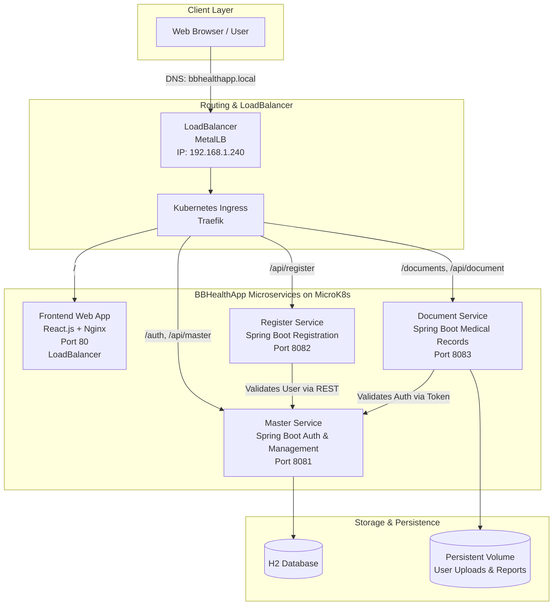

# BBHealthApp - Enterprise Healthcare Microservices Platform

[](https://github.com/Ajit-Swami/BBHealthApp/blob/main/Jenkinsfile)
[](https://github.com/Ajit-Swami/BBHealthApp/blob/main/k8s/)
[](https://hub.docker.com/u/ajit189)
[](https://github.com/Ajit-Swami/BBHealthApp/tree/main/bbhealthapp-backend)
[](https://github.com/Ajit-Swami/BBHealthApp/tree/main/bbhealthapp-frontend)

**BBHealthApp** is a healthcare and COVID-19 health management system built on a microservices architecture. It provides role-based workflows for Patients, Doctors, Diagnostic Testers, and Government Authorities, featuring automated container builds, Kubernetes orchestration with MicroK8s, LoadBalancer with DNS support, and end-to-end Jenkins CI/CD automation on a single EC2 instance.

---

## Architecture Diagram



---

## Technology Stack

| Domain | Technologies |
|---|---|
| **Frontend** | React.js, Material-UI, Redux, Axios, Nginx container |
| **Backend Microservices** | Spring Boot 2.x, Java 11, Spring Security (JWT), Maven |
| **Database & Storage** | H2 Database (sa/sa), Kubernetes PersistentVolumeClaims (PVC) |
| **Containerization** | Docker, Multi-Stage Builds, Docker Hub Registry |
| **Kubernetes Orchestration** | MicroK8s, Native Kubernetes Manifests (`k8s/`), MetalLB LoadBalancer |
| **CI/CD Automation** | Jenkins Pipeline (`Jenkinsfile`), Docker, `kubectl` |
| **Infrastructure** | AWS EC2 (Ubuntu), DNS (bbhealthapp.local) |

---

## Project Structure

```
bb-Healthapp-sourcecode/
├── bbhealthapp-frontend/              # React frontend application
│   ├── src/                          # React source code & components
│   ├── public/                       # Static public assets
│   ├── nginx.conf                    # Nginx reverse proxy configuration
│   └── Dockerfile                    # Multi-stage production container build
├── bbhealthapp-backend/               # Spring Boot microservices
│   ├── bbhealthapp-api-master/       # Master service (Auth, approvals, user data)
│   ├── bbhealthapp-api-register/     # Register service (Patient/Doctor/Tester registration)
│   └── bbhealthapp-api-document/     # Document service (Upload/Download medical documents)
├── k8s/                              # Native Kubernetes manifests
│   ├── namespace.yaml                # Dedicated `bbhealthapp` namespace
│   ├── configmap.yaml                # Application environment configuration
│   ├── secret.yaml                   # Sensitive credentials and JWT secrets
│   ├── pvc.yaml                      # Persistent storage for uploads
│   ├── master-service-deployment.yaml# Master service deployment & ClusterIP
│   ├── register-service-deployment.yaml # Register service deployment & ClusterIP
│   ├── document-service-deployment.yaml # Document service deployment & ClusterIP
│   ├── frontend-deployment.yaml      # React deployment & LoadBalancer service
│   ├── ingress.yaml                  # Path-based Ingress routing with DNS
│   ├── metallb-config.yaml           # MetalLB LoadBalancer configuration
│   └── DNS-SETUP.md                  # DNS configuration guide
├── Jenkinsfile                       # Jenkins CI/CD pipeline (Docker Hub + MicroK8s)
├── Jenkinsfile-k8s                   # Alternative Kubernetes deployment pipeline
├── Jenkinsfile-simple                # Simple Docker-only deployment pipeline
└── README.md                         # This file
```

---

## Deployment Architecture

### Single EC2 Instance Setup

The entire application runs on a single AWS EC2 instance with:
- **MicroK8s**: Lightweight Kubernetes cluster
- **Jenkins**: CI/CD automation server
- **Docker**: Container runtime for building images
- **MetalLB**: LoadBalancer implementation for Kubernetes
- **Traefik**: Ingress controller for routing
- **DNS**: bbhealthapp.local for frontend access

---

## Deployment Guide

### Prerequisites

- AWS EC2 instance (Ubuntu 22.04/24.04 LTS)
- Instance type: t3.medium or larger (2 vCPU, 4 GB RAM minimum)
- Docker Hub account
- Git repository access

### Step 1: Launch EC2 Instance

1. Go to AWS Console → EC2 → Launch Instance
2. Name: `bbhealthapp-server`
3. OS: Ubuntu 22.04 LTS or 24.04 LTS
4. Instance type: `t3.medium` (2 vCPU, 4 GB RAM)
5. Key pair: Create or select existing
6. Security Group - Allow:
   - SSH (port 22) from your IP
   - HTTP (port 80) from 0.0.0.0/0
   - HTTPS (port 443) from 0.0.0.0/0
   - Custom port 8080 (Jenkins) from your IP
7. Storage: 30 GB GP3
8. Launch

### Step 2: Connect to EC2

```bash
chmod 400 your-key-pem.pem
ssh -i your-key-pem.pem ubuntu@<EC2-PUBLIC-IP>
```

### Step 3: Install MicroK8s

```bash
# Update packages
sudo apt update

# Install snapd
sudo apt install snapd -y

# Install MicroK8s
sudo snap install microk8s --classic

# Wait for MicroK8s to be ready
sudo microk8s status --wait-ready

# Enable required addons
sudo microk8s enable dns
sudo microk8s enable ingress
sudo microk8s enable storage

# Create kubectl alias
echo 'alias kubectl="sudo microk8s.kubectl"' >> ~/.bashrc
source ~/.bashrc

# Verify MicroK8s
kubectl get nodes
```

### Step 4: Install Docker

```bash
# Install Docker
curl -fsSL https://get.docker.com -o get-docker.sh
sudo sh get-docker.sh

# Add ubuntu user to docker group
sudo usermod -aG docker ubuntu

# Verify Docker
sudo docker --version
```

### Step 5: Install Jenkins

```bash
# Install Java
sudo apt update
sudo apt install -y openjdk-17-jdk

# Add Jenkins repository
curl -fsSL https://pkg.jenkins.io/debian-stable/jenkins.io-2023.key | sudo tee \
  /usr/share/keyrings/jenkins-keyring.asc > /dev/null

echo deb [signed-by=/usr/share/keyrings/jenkins-keyring.asc] \
  https://pkg.jenkins.io/debian-stable binary/ | sudo tee \
  /etc/apt/sources.list.d/jenkins.list > /dev/null

# Install Jenkins
sudo apt update
sudo apt install -y jenkins

# Start Jenkins
sudo systemctl start jenkins
sudo systemctl enable jenkins

# Get initial admin password
sudo cat /var/lib/jenkins/secrets/initialAdminPassword
```

### Step 6: Configure Jenkins for MicroK8s

```bash
# Create kubeconfig for Jenkins user
sudo microk8s config > /var/lib/jenkins/.kube/config
sudo chown jenkins:jenkins /var/lib/jenkins/.kube/config
sudo chmod 600 /var/lib/jenkins/.kube/config

# Install kubectl for Jenkins user
sudo -u jenkins curl -LO "https://dl.k8s.io/release/$(curl -L -s https://dl.k8s.io/release/stable.txt)/bin/linux/amd64/kubectl"
sudo -u jenkins sudo install kubectl /usr/local/bin/

# Test kubectl as Jenkins user
sudo -u jenkins kubectl get nodes
```

### Step 7: Configure Jenkins Credentials

**In Jenkins UI:**
1. Go to `http://<EC2-PUBLIC-IP>:8080`
2. Enter initial admin password
3. Install suggested plugins
4. Create admin user
5. Add Docker Hub credentials:
   - Manage Jenkins → Credentials → System → Global credentials
   - Add Credentials:
     - Kind: Username with password
     - Username: Your Docker Hub username
     - Password: Your Docker Hub password
     - ID: `docker-hub-credentials`

### Step 8: Create Jenkins Pipeline

**In Jenkins UI:**
1. New Item → Name: `bbhealthapp-deploy` → Pipeline
2. Configure:
   - Definition: Pipeline script from SCM
   - SCM: Git
   - Repository URL: `https://github.com/Ajit-Swami/BBHealthApp.git`
   - Script Path: `Jenkinsfile`
3. Save

### Step 9: Run Jenkins Pipeline

1. Click "Build Now"
2. Pipeline will:
   - Checkout code from GitHub
   - Build 4 Docker images (master, register, document, frontend)
   - Push images to Docker Hub
   - Install MetalLB for LoadBalancer support
   - Deploy to MicroK8s
   - Configure LoadBalancer with DNS
   - Verify deployment

### Step 10: Configure DNS

After deployment, get the LoadBalancer IP:

```bash
kubectl get svc frontend -n bbhealthapp
```

**Option A: Local /etc/hosts (For Testing)**
```bash
# On your local machine
echo "<LOADBALANCER-IP> bbhealthapp.local" | sudo tee -a /etc/hosts
```

**Option B: Cloud DNS (For Production)**
Create an A record in your DNS provider:
- Name: `bbhealthapp`
- Type: A
- Value: `<LOADBALANCER-IP>`

See [k8s/DNS-SETUP.md](k8s/DNS-SETUP.md) for detailed DNS configuration.

### Step 11: Access Application

```
Frontend:    http://bbhealthapp.local
Master API:  http://bbhealthapp.local/api/master
Register API: http://bbhealthapp.local/api/register
Document API: http://bbhealthapp.local/api/document
```

---

## API Endpoints Reference

### Master Service (`:8081`)
| Method | Endpoint | Description |
|---|---|---|
| `POST` | `/auth/login` | Authenticate user and issue JWT |
| `GET` | `/auth/validateusername/{username}/{email}/{phone}` | Validate uniqueness of credentials |
| `GET` | `/api/government/pending-approvals` | Fetch registrations awaiting government review |
| `PUT` | `/api/government/update-approval` | Approve or reject a user account |

### Register Service (`:8082`)
| Method | Endpoint | Description |
|---|---|---|
| `POST` | `/auth/register` | Register a new Patient |
| `POST` | `/auth/doctor/register` | Register a new Doctor |
| `POST` | `/auth/tester/register` | Register a new Diagnostic Tester |

### Document Service (`:8083`)
| Method | Endpoint | Description |
|---|---|---|
| `POST` | `/documents/upload` | Upload diagnostic reports / test results |
| `GET` | `/documents/download` | Download medical documents |
| `GET` | `/documents/getPendingApprovals` | Retrieve unapproved uploaded documents |

---

## Default Test Credentials

| Username | Password | Role | Description |
|---|---|---|---|
| `user` | `password` | **Patient** | View personal COVID-19 health records & test reports |
| `doctor` | `password` | **Doctor** | Review patient diagnoses, consultations, and lab results |
| `tester` | `password` | **Tester** | Conduct diagnostic tests & upload lab documents |
| `authority` | `password` | **Government** | Authorize provider accounts and verify compliance |

---

## Database Console Access

- **Web Console URL**: http://localhost:8081/h2-console
- **JDBC Driver**: `org.h2.Driver`
- **JDBC URL**: `jdbc:h2:file:~/binarybrainscovid`
- **Username**: `sa`
- **Password**: `sa`

---

## Troubleshooting

### MicroK8s Issues

```bash
# Check MicroK8s status
sudo microk8s status

# Check pods
kubectl get pods -A

# Check MicroK8s logs
sudo microk8s inspect
```

### LoadBalancer Issues

```bash
# Check MetalLB pods
kubectl get pods -n metallb-system

# Check MetalLB logs
kubectl logs -n metallb-system -l app=metallb-controller

# Check LoadBalancer IP
kubectl get svc frontend -n bbhealthapp
```

### Jenkins Issues

```bash
# Check Jenkins status
sudo systemctl status jenkins

# Check Jenkins logs
sudo journalctl -u jenkins -f

# Test kubectl as Jenkins user
sudo -u jenkins kubectl get nodes
```

---

## Project Documentation

- [DNS Setup Guide](k8s/DNS-SETUP.md) - Complete DNS configuration for LoadBalancer
- [Jenkinsfile](Jenkinsfile) - CI/CD pipeline configuration
- [Jenkinsfile-k8s](Jenkinsfile-k8s) - Alternative Kubernetes deployment pipeline
- [Jenkinsfile-simple](Jenkinsfile-simple) - Simple Docker-only deployment

---

## Features

- ✅ **Microservices Architecture**: Independent Spring Boot services
- ✅ **Kubernetes Orchestration**: MicroK8s on single EC2 instance
- ✅ **LoadBalancer with DNS**: MetalLB for external access
- ✅ **CI/CD Automation**: Jenkins pipeline for automated deployments
- ✅ **Docker Hub Integration**: Container registry for images
- ✅ **Role-Based Access**: Patient, Doctor, Tester, Government roles
- ✅ **Document Management**: Upload/Download medical records
- ✅ **Persistent Storage**: PVC for document uploads
- ✅ **Ingress Routing**: Path-based routing with Traefik

---

## License

This project is licensed under the MIT License.

---

## Author

**Ajit Swami** - [GitHub](https://github.com/Ajit-Swami)
