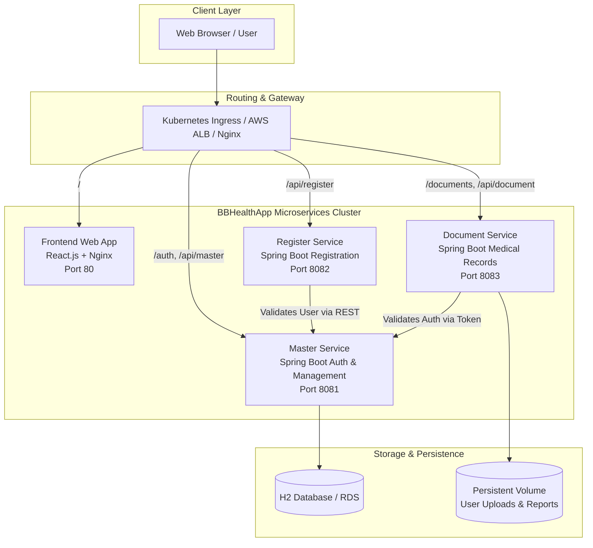
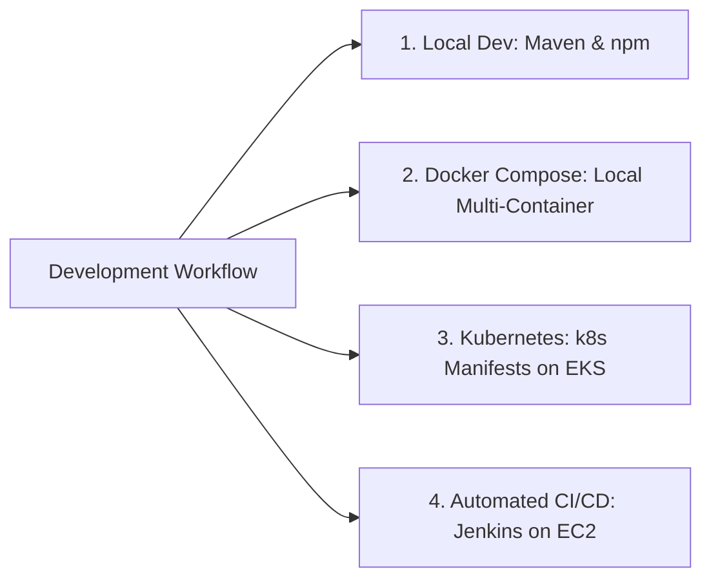
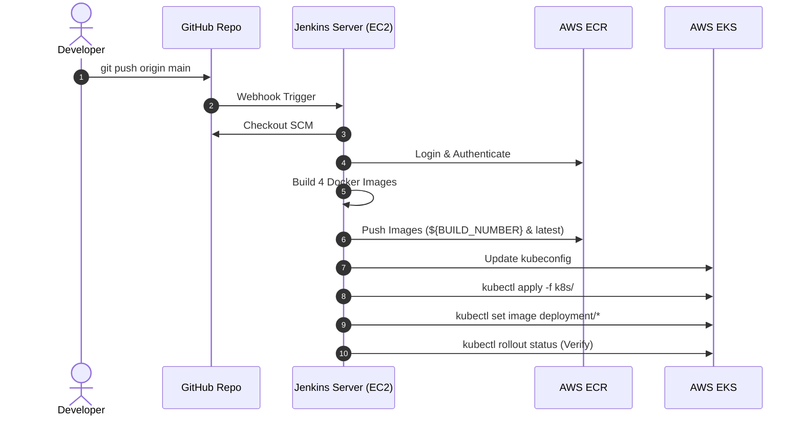

# BBHealthApp - Enterprise Healthcare Microservices Platform

[](file:///d:/BBHealthApp/bb-Healthapp-sourcecode/Jenkinsfile)
[](file:///d:/BBHealthApp/bb-Healthapp-sourcecode/k8s/)
[](file:///d:/BBHealthApp/bb-Healthapp-sourcecode/terraform/)
[](file:///d:/BBHealthApp/bb-Healthapp-sourcecode/docker-compose.yml)
[](file:///d:/BBHealthApp/bb-Healthapp-sourcecode/bbhealthapp-backend/)
[](file:///d:/BBHealthApp/bb-Healthapp-sourcecode/bbhealthapp-frontend/)

**BBHealthApp** is a healthcare and COVID-19 health management system built on a microservices architecture. It provides role-based workflows for Patients, Doctors, Diagnostic Testers, and Government Authorities, featuring automated container builds, Infrastructure as Code on AWS, Kubernetes orchestration (without Helm), and end-to-end Jenkins CI/CD automation.

---

## Architecture Diagram



---

## Technology Stack

| Domain | Technologies |
|---|---|
| **Frontend** | React.js, Material-UI, Redux, Axios, Nginx container |
| **Backend Microservices** | Spring Boot 2.x, Java 11, Spring Security (JWT), Maven |
| **Database & Storage** | H2 Database (sa/sa), Kubernetes PersistentVolumeClaims (PVC) |
| **Containerization** | Docker, Multi-Stage Builds, Docker Compose |
| **Infrastructure as Code** | Terraform (AWS VPC, Subnets, EKS Cluster, ECR, IAM, SGs) |
| **Kubernetes Orchestration** | Native Kubernetes Manifests (`k8s/`), Ingress, Kustomize (**No Helm**) |
| **CI/CD Automation** | Jenkins Pipeline (`Jenkinsfile`), AWS CLI v2, Docker, `kubectl` |

---

## Project Structure

```
bb-Healthapp-sourcecode/
├── bbhealthapp-frontend/              # React frontend application
│   ├── src/                          # React source code & components
│   ├── public/                       # Static public assets
│   ├── nginx.conf                    # Nginx reverse proxy configuration
│   └── Dockerfile                    # Multi-stage production container build
├── bbhealthapp-backend/               # Spring Boot microservices
│   ├── bbhealthapp-api-master/       # Master service (Auth, approvals, user data)
│   ├── bbhealthapp-api-register/     # Register service (Patient/Doctor/Tester registration)
│   └── bbhealthapp-api-document/     # Document service (Upload/Download medical documents)
├── k8s/                              # Native Kubernetes manifests (No Helm)
│   ├── namespace.yaml                # Dedicated `bbhealthapp` namespace
│   ├── configmap.yaml                # Application environment configuration
│   ├── secret.yaml                   # Sensitive credentials and JWT secrets
│   ├── pvc.yaml                      # Persistent storage for uploads
│   ├── master-service-deployment.yaml# Master service deployment & ClusterIP
│   ├── register-service-deployment.yaml # Register service deployment & ClusterIP
│   ├── document-service-deployment.yaml # Document service deployment & ClusterIP
│   ├── frontend-deployment.yaml      # React deployment & LoadBalancer service
│   ├── ingress.yaml                  # Path-based Ingress routing
│   └── kustomization.yaml            # Single-command Kustomize deployment
├── terraform/                        # AWS Infrastructure as Code
│   ├── vpc.tf, subnets, nat          # Production VPC with public/private subnets
│   ├── eks.tf                        # Amazon EKS cluster & managed node groups
│   ├── ecr.tf                        # Amazon ECR container registries for all 4 services
│   ├── iam.tf, security-groups.tf    # Least-privilege IAM roles and security policies
│   └── variables.tf, terraform.tfvars# Configurable cluster and networking settings
├── Jenkinsfile                       # Production declarative Jenkins CI/CD pipeline
├── setup-jenkins-ec2.sh              # EC2 bootstrap script for Jenkins & dependencies
├── docker-compose.yml                # Local multi-container Docker development
├── build-images.sh / .ps1            # Docker build scripts
├── deploy.sh / .ps1                  # Kubernetes manifest deployment scripts
├── DOCKER_SETUP.md                   # Docker installation & orchestration guide
├── KUBERNETES_DEPLOYMENT.md          # Pure Kubernetes deployment guide
├── terraform_setup.md                # Terraform AWS provisioning guide
└── JENKINS_EKS_DEPLOYMENT.md         # Jenkins CI/CD to AWS EKS deployment guide
```

---

## Execution & Deployment Options

You can run and deploy BBHealthApp in four different modes depending on your workflow:



---

### Option 1: Local Development (Bare-Metal)

#### Prerequisites
- Node.js (v16+) & npm
- Java 11 JDK
- Apache Maven (v3.8+)

#### 1. Start Backend Services
Open 3 separate terminals to start the microservices:

```bash
# Terminal 1 - Master Service (Port 8081)
cd bbhealthapp-backend/bbhealthapp-api-master
mvn clean spring-boot:run

# Terminal 2 - Register Service (Port 8082)
cd bbhealthapp-backend/bbhealthapp-api-register
mvn clean spring-boot:run

# Terminal 3 - Document Service (Port 8083)
cd bbhealthapp-backend/bbhealthapp-api-document
mvn clean spring-boot:run
```

#### 2. Start Frontend Application
```bash
# Terminal 4 - React Frontend (Port 3000)
cd bbhealthapp-frontend
npm install
npm start
```

---

### Option 2: Local Multi-Container with Docker Compose

Run the entire microservices stack with a single command:

```bash
# Build and run all services in background
docker-compose up --build -d

# Check running containers
docker-compose ps

# View live service logs
docker-compose logs -f

# Stop and clean up containers
docker-compose down
```

See [DOCKER_SETUP.md](file:///d:/BBHealthApp/bb-Healthapp-sourcecode/DOCKER_SETUP.md) for detailed container instructions.

---

### Option 3: AWS Infrastructure Provisioning with Terraform

Provision the AWS VPC, Amazon EKS Cluster, and Amazon ECR Registries:

```bash
cd terraform

# Initialize providers
terraform init

# Plan infrastructure
terraform plan

# Apply and provision AWS resources
terraform apply -auto-approve
```

See [terraform_setup.md](file:///d:/BBHealthApp/bb-Healthapp-sourcecode/terraform_setup.md) for full configuration details.

---

### Option 4: Kubernetes Deployment to EKS (Pure Manifests - No Helm)

Deploy the application manifests directly to an active Kubernetes cluster:

```bash
# Make deploy script executable and run
chmod +x deploy.sh
./deploy.sh

# Or apply manually using kubectl
kubectl apply -f k8s/namespace.yaml
kubectl apply -f k8s/configmap.yaml
kubectl apply -f k8s/secret.yaml
kubectl apply -f k8s/pvc.yaml
kubectl apply -f k8s/

# Verify cluster resources
kubectl get pods,svc,pvc,ingress -n bbhealthapp
```

See [KUBERNETES_DEPLOYMENT.md](file:///d:/BBHealthApp/bb-Healthapp-sourcecode/KUBERNETES_DEPLOYMENT.md) for pure manifest deployment notes.

---

### Option 5: Automated Jenkins CI/CD on AWS EC2

Deploy end-to-end using the automated Jenkins pipeline:



#### Step 1: Bootstrap Jenkins on EC2
Run the automated bootstrap script on your Ubuntu EC2 instance:
```bash
chmod +x setup-jenkins-ec2.sh
./setup-jenkins-ec2.sh
```

#### Step 2: Configure Jenkins
1. Open `http://<EC2-PUBLIC-IP>:8080`.
2. Retrieve the admin password: `sudo cat /var/lib/jenkins/secrets/initialAdminPassword`.
3. Install plugins: **Pipeline**, **Git**, **Docker Pipeline**, **AWS Steps**.
4. Add AWS credentials with ID `aws-credentials` in Jenkins Credentials Store.

#### Step 3: Run the Pipeline
1. Create a Pipeline Job pointing to `Jenkinsfile`.
2. Click **Build with Parameters** (`AWS_REGION=us-west-2`, `CLUSTER_NAME=bbhealthapp-dev`).
3. Monitor real-time logs and verify rolling update on EKS.

See [JENKINS_EKS_DEPLOYMENT.md](file:///d:/BBHealthApp/bb-Healthapp-sourcecode/JENKINS_EKS_DEPLOYMENT.md) for complete details.

---

## API Endpoints Reference

### Master Service (`:8081`)
| Method | Endpoint | Description |
|---|---|---|
| `POST` | `/auth/login` | Authenticate user and issue JWT |
| `GET` | `/auth/validateusername/{username}/{email}/{phone}` | Validate uniqueness of credentials |
| `GET` | `/api/government/pending-approvals` | Fetch registrations awaiting government review |
| `PUT` | `/api/government/update-approval` | Approve or reject a user account |

### Register Service (`:8082`)
| Method | Endpoint | Description |
|---|---|---|
| `POST` | `/auth/register` | Register a new Patient |
| `POST` | `/auth/doctor/register` | Register a new Doctor |
| `POST` | `/auth/tester/register` | Register a new Diagnostic Tester |

### Document Service (`:8083`)
| Method | Endpoint | Description |
|---|---|---|
| `POST` | `/documents/upload` | Upload diagnostic reports / test results |
| `GET` | `/documents/download` | Download medical documents |
| `GET` | `/documents/getPendingApprovals` | Retrieve unapproved uploaded documents |

---

## Default Test Credentials

| Username | Password | Role | Description |
|---|---|---|---|
| `user` | `password` | **Patient** | View personal COVID-19 health records & test reports |
| `doctor` | `password` | **Doctor** | Review patient diagnoses, consultations, and lab results |
| `tester` | `password` | **Tester** | Conduct diagnostic tests & upload lab documents |
| `authority` | `password` | **Government** | Authorize provider accounts and verify compliance |

---

## Database Console Access

- **Web Console URL**: http://localhost:8081/h2-console
- **JDBC Driver**: `org.h2.Driver`
- **JDBC URL**: `jdbc:h2:file:~/binarybrainscovid`
- **Username**: `sa`
- **Password**: `sa`

---

## Project Documentation Index

- [Jenkins CI/CD to EKS Guide (No Helm)](file:///d:/BBHealthApp/bb-Healthapp-sourcecode/JENKINS_EKS_DEPLOYMENT.md)
- [Kubernetes Pure Manifests Guide](file:///d:/BBHealthApp/bb-Healthapp-sourcecode/KUBERNETES_DEPLOYMENT.md)
- [Terraform AWS Infrastructure Guide](file:///d:/BBHealthApp/bb-Healthapp-sourcecode/terraform_setup.md)
- [Docker & Containerization Guide](file:///d:/BBHealthApp/bb-Healthapp-sourcecode/DOCKER_SETUP.md)
- [Jenkinsfile Pipeline Code](file:///d:/BBHealthApp/bb-Healthapp-sourcecode/Jenkinsfile)
- [EC2 Automated Jenkins Setup Script](file:///d:/BBHealthApp/bb-Healthapp-sourcecode/setup-jenkins-ec2.sh)
