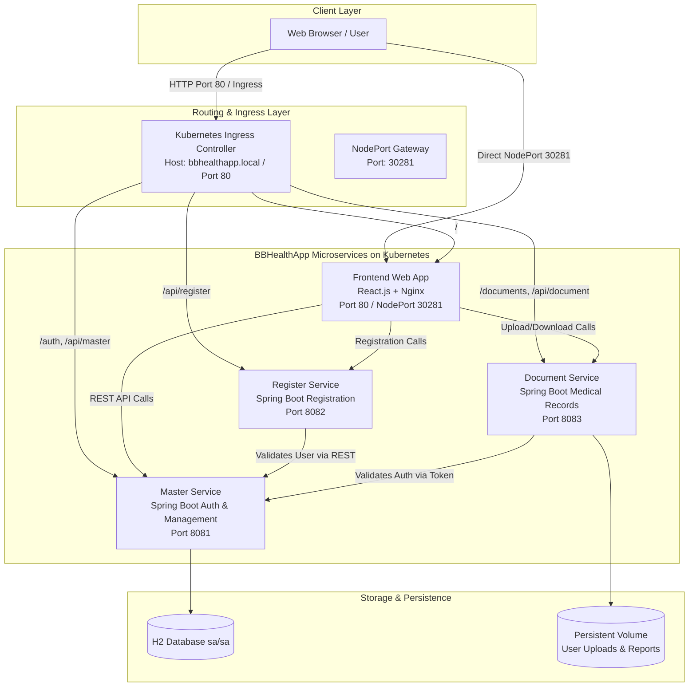

# BBHealthApp - Enterprise Healthcare Microservices Platform

[](https://github.com/Ajit-Swami/BBHealthApp/blob/main/Jenkinsfile)
[](https://github.com/Ajit-Swami/BBHealthApp/blob/main/k8s/)
[](https://hub.docker.com/u/ajit189)
[](https://github.com/Ajit-Swami/BBHealthApp/tree/main/bbhealthapp-backend)
[](https://github.com/Ajit-Swami/BBHealthApp/tree/main/bbhealthapp-frontend)

**BBHealthApp** is a healthcare and COVID-19 health management system built on a cloud-native microservices architecture. It provides role-based workflows for Patients, Doctors, Diagnostic Testers, and Government Authorities, featuring automated container builds, Kubernetes orchestration on AWS EC2, and end-to-end Jenkins CI/CD automation.

---

## Architecture Diagram



---

## Technology Stack

| Domain | Technologies |
|---|---|
| **Frontend** | React.js, Material-UI, Redux, Axios, Nginx Web Server |
| **Backend Microservices** | Spring Boot 2.x, Java 11, Spring Security (JWT), Maven |
| **Database & Storage** | H2 Database (sa/sa), Kubernetes PersistentVolumeClaims (PVC) |
| **Containerization** | Docker, Multi-Stage Builds, Docker Hub Registry (`ajit189`) |
| **Kubernetes Orchestration** | Kubernetes (MicroK8s / K3s / EKS), Native Manifests (`k8s/`) |
| **Infrastructure as Code** | Terraform (`terraform/` AWS VPC, EKS, ECR, IAM, ALB) |
| **CI/CD Automation** | Jenkins Pipeline (`Jenkinsfile`), Docker Engine, `kubectl` |
| **Cloud Hosting** | AWS EC2 (Ubuntu 22.04 LTS), AWS EKS |

---

## Project Structure

```
bb-Healthapp-sourcecode/
├── bbhealthapp-frontend/              # React frontend application
│   ├── src/                          # React source code & components
│   ├── public/                       # Static public assets
│   ├── nginx.conf                    # Nginx reverse proxy configuration
│   └── Dockerfile                    # Multi-stage production container build
├── bbhealthapp-backend/               # Spring Boot microservices
│   ├── bbhealthapp-api-master/       # Master service (Auth, approvals, user data)
│   ├── bbhealthapp-api-register/     # Register service (Patient/Doctor/Tester registration)
│   └── bbhealthapp-api-document/     # Document service (Upload/Download medical documents)
├── k8s/                              # Native Kubernetes manifests
│   ├── namespace.yaml                # Dedicated `bbhealthapp` namespace
│   ├── configmap.yaml                # Application environment configuration
│   ├── secret.yaml                   # Sensitive credentials and JWT secrets
│   ├── pvc.yaml                      # Persistent storage for uploads
│   ├── master-service-deployment.yaml# Master service deployment & ClusterIP
│   ├── register-service-deployment.yaml # Register service deployment & ClusterIP
│   ├── document-service-deployment.yaml # Document service deployment & ClusterIP
│   ├── frontend-deployment.yaml      # React deployment & LoadBalancer / NodePort service
│   ├── ingress.yaml                  # Path-based Ingress routing
│   └── kustomization.yaml            # Single-command Kustomize deploy
├── terraform/                        # Production AWS IaC (VPC, EKS, ECR, IAM)
├── Jenkinsfile                       # Main CI/CD pipeline (Docker Hub + Kubernetes)
├── Jenkinsfile-k8s                   # Alternative Kubernetes deployment pipeline
├── Jenkinsfile-simple                # Docker-only deployment pipeline
├── deploy.sh                         # Automated bash script for k8s deployment
├── build-images.sh                   # Script to build all 4 Docker containers
└── README.md                         # Project documentation
```

---

## Quick Start: Deploy on AWS EC2

### 1. Launch EC2 Instance & Security Groups
- **OS:** Ubuntu 22.04 LTS
- **Instance Type:** `t3.medium` (minimum 2 vCPU, 4 GB RAM)
- **Storage:** 30 GB gp3
- **Security Group Inbound Rules:**
  - `SSH` (22) from your IP
  - `HTTP` (80) from `0.0.0.0/0`
  - `Custom TCP` (`30281`) from `0.0.0.0/0` (Frontend NodePort)
  - `Custom TCP` (`8080`) from `0.0.0.0/0` (Jenkins)
  - `Custom TCP` (`8081-8083`) from `0.0.0.0/0` (Backend APIs)

### 2. Connect & Install Prerequisites

```bash
# Update packages
sudo apt update && sudo apt install -y git curl

# Install Docker
curl -fsSL https://get.docker.com -o get-docker.sh
sudo sh get-docker.sh
sudo usermod -aG docker $USER
newgrp docker

# Install MicroK8s (or K3s)
sudo snap install microk8s --classic
sudo microk8s status --wait-ready
sudo microk8s enable dns ingress storage
sudo snap alias microk8s.kubectl kubectl
```

### 3. Deploy Kubernetes Manifests

```bash
git clone https://github.com/Ajit-Swami/BBHealthApp.git
cd BBHealthApp

# Deploy all manifests
chmod +x deploy.sh
./deploy.sh
```

### 4. Enable Background Port-Forwards for Backend APIs

```bash
nohup kubectl port-forward -n bbhealthapp --address 0.0.0.0 svc/master-service 8081:8081 > /dev/null 2>&1 &
nohup kubectl port-forward -n bbhealthapp --address 0.0.0.0 svc/register-service 8082:8082 > /dev/null 2>&1 &
nohup kubectl port-forward -n bbhealthapp --address 0.0.0.0 svc/document-service 8083:8083 > /dev/null 2>&1 &
```

---

## Jenkins CI/CD Pipeline Setup

The automated pipeline (`Jenkinsfile`) pulls code from GitHub, builds all 4 Docker images, pushes them to Docker Hub (`ajit189`), and performs rolling deployments to Kubernetes.

### 1. Install Jenkins on EC2

```bash
# Install Java 17
sudo apt update && sudo apt install -y openjdk-17-jdk

# Add Jenkins Repo
sudo mkdir -p /etc/apt/keyrings
curl -fsSL https://pkg.jenkins.io/debian-stable/jenkins.io-2023.key | sudo tee /etc/apt/keyrings/jenkins-keyring.asc > /dev/null
echo deb [signed-by=/etc/apt/keyrings/jenkins-keyring.asc] https://pkg.jenkins.io/debian-stable binary/ | sudo tee /etc/apt/sources.list.d/jenkins.list > /dev/null

# Install & Start Jenkins
sudo apt update && sudo apt install -y jenkins
sudo usermod -aG docker jenkins
sudo systemctl restart docker jenkins

# Configure kubeconfig for Jenkins
sudo mkdir -p /var/lib/jenkins/.kube
sudo microk8s config | sudo tee /var/lib/jenkins/.kube/config > /dev/null
sudo chown -R jenkins:jenkins /var/lib/jenkins/.kube
sudo chmod 600 /var/lib/jenkins/.kube/config
```

### 2. Configure Pipeline in Jenkins
1. Open `http://<EC2-PUBLIC-IP>:8080` and unlock with `sudo cat /var/lib/jenkins/secrets/initialAdminPassword`.
2. Install suggested plugins and create admin credentials.
3. Add Docker Hub credentials:
   - **Manage Jenkins** → **Credentials** → **System** → **Global credentials**
   - Kind: `Username with password`
   - ID: `docker-hub-credentials`
4. Create a new **Pipeline** job:
   - Definition: `Pipeline script from SCM`
   - SCM: `Git`
   - Repository URL: `https://github.com/Ajit-Swami/BBHealthApp.git`
   - Branch: `*/main`
   - Script Path: `Jenkinsfile`
5. Click **Build Now**.

---

## User Roles & Test Credentials

The platform includes pre-seeded accounts for demonstrating the end-to-end healthcare workflow:

| Role | Username | Password | Purpose & Capabilities |
|---|---|---|---|
| **Patient** | `user` | `password` | Create COVID-19 test requests, track diagnosis and lab reports |
| **Lab Tester** | `tester` | `password` | Assign initiated tests to self, record vitals (BP, O2, Temp), record test status |
| **Doctor** | `doctor` | `password` | Review lab vitals, assign consultations, prescribe home quarantine or hospital admission |
| **Government Authority** | `authority` | `password` | Review and approve pending doctors/testers, set regional zone thresholds, monitor statistics |

---

## Access Points

| Component | URL / Port |
|---|---|
| **Frontend Web Application** | `http://<EC2-PUBLIC-IP>:30281/login` |
| **Master Service API** | `http://<EC2-PUBLIC-IP>:8081/auth/greetings` |
| **Register Service API** | `http://<EC2-PUBLIC-IP>:8082` |
| **Document Service API** | `http://<EC2-PUBLIC-IP>:8083` |
| **Jenkins Dashboard** | `http://<EC2-PUBLIC-IP>:8080` |
| **H2 Database Console** | `http://<EC2-PUBLIC-IP>:8081/h2-console` |

---

## Useful Verification Commands

```bash
# Check all resources
kubectl get all,pvc,ingress -n bbhealthapp

# Stream service logs
kubectl logs -f -l app=master-service -n bbhealthapp
kubectl logs -f -l app=frontend -n bbhealthapp

# Verify listening ports
netstat -tuln | grep -E '8081|8082|8083|30281'
```

---

## License

This project is licensed under the MIT License.

## Author

**Ajit Swami** - [GitHub Profile](https://github.com/Ajit-Swami)
