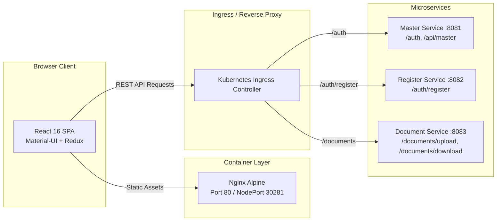

# BBHealthApp - Frontend Web Application

[](https://reactjs.org/)
[](https://redux.js.org/)
[](https://material-ui.com/)
[](https://nginx.org/)
[](https://hub.docker.com/r/ajit189/bbhealthapp-frontend)

The modern, responsive web application for **BBHealthApp** — a comprehensive COVID-19 health tracking and medical management platform. Built using React.js with Redux for state management, styled with Material-UI, and served via an optimized Nginx container.

---

## Table of Contents
- [Architecture Overview](#architecture-overview)
- [Key Features](#key-features)
- [Technology Stack](#technology-stack)
- [Project Directory Structure](#project-directory-structure)
- [Local Development Setup](#local-development-setup)
  - [Prerequisites](#prerequisites)
  - [Windows Setup (OpenSSL Workaround)](#windows-setup-openssl-workaround)
  - [Linux / macOS Setup](#linux--macos-setup)
- [Available npm Scripts](#available-npm-scripts)
- [Environment Configuration](#environment-configuration)
- [Docker Containerization](#docker-containerization)
  - [Multi-Stage Build](#multi-stage-build)
  - [Running Container Locally](#running-container-locally)
- [Kubernetes & Ingress Integration](#kubernetes--ingress-integration)
- [User Roles & Test Credentials](#user-roles--test-credentials)
- [Troubleshooting & FAQs](#troubleshooting--faqs)

---

## Architecture Overview

The frontend communicates with three independent Spring Boot microservices either through direct endpoints or an Ingress reverse proxy:



---

## Key Features

- **Role-Based Dynamic Portals:** Custom workflows and dashboards tailored for:
  - **Patients:** Book COVID-19 test requests, upload identity documents, view test results and diagnostic status.
  - **Lab Testers:** Claim pending tests, record patient vitals (Blood Pressure, SpO2, Body Temperature), and submit lab reports.
  - **Doctors:** Review medical vitals, conduct virtual consultations, and assign home quarantine or hospital admission.
  - **Government Authorities:** Manage city/zone health thresholds, approve registered medical staff, and review statistical charts.
- **State Management & Persistence:** Centralized store using Redux Toolkit with `redux-persist` to maintain session authentication and token validation across page reloads.
- **Data Visualizations:** Interactive real-time COVID-19 analytical charts powered by `chart.js` and `react-chartjs-2`.
- **Responsive Layout:** Material-UI Grid system with flexible themes, responsive navigation drawer, and cross-browser compatibility.

---

## Technology Stack

| Category | Technology | Version | Purpose |
|---|---|---|---|
| **Core Framework** | React.js | `16.14.0` | UI Component Framework |
| **State Management** | Redux / Redux Toolkit | `^4.0.5` / `^1.4.0` | Global state and session storage |
| **Routing** | React Router DOM | `^5.2.0` | Client-side declarative routing |
| **Component Library** | Material-UI (`@material-ui/core`) | `^4.11.0` | Pre-built accessible UI components |
| **Data Visualization** | Chart.js / `react-chartjs-2` | `^2.9.3` / `^2.10.0` | Interactive charts for health statistics |
| **HTTP Client** | Axios | `^0.27.2` | REST API communication with JWT interceptors |
| **Build Tooling** | `react-app-rewired` / Webpack | `3.4.3` | Custom Webpack configuration & build pipelines |
| **Production Server** | Nginx Alpine | `latest` | High-performance static SPA serving & proxy |

---

## Project Directory Structure

```
bbhealthapp-frontend/
├── public/                     # Public static files and index.html
├── src/
│   ├── auth/                   # Authentication logic, login forms, JWT decoding
│   ├── authority/              # Government Authority dashboards and threshold controls
│   ├── component/              # Reusable UI widgets (navbars, buttons, alerts, tables)
│   ├── config/                 # Axios interceptors, route guards, and base constants
│   ├── consultation/           # Doctor consultation workflows & diagnostic forms
│   ├── documents/              # File upload, viewing, and prescription downloads
│   ├── lab/                    # Lab tester queues, sample collection, and vital forms
│   ├── profile/                # User profile, account settings, and password update
│   ├── testrequests/           # COVID-19 test creation, status tracking, and lists
│   ├── environment.js          # API routing configuration for Ingress and microservices
│   ├── App.js                  # Main application routing and role switchboard
│   └── index.js                # React DOM entry point and Redux store provider
├── .env                        # Local environment variables
├── Dockerfile                  # Multi-stage production container definition
├── nginx.conf                  # Nginx SPA fallback and caching configuration
├── package.json                # Dependencies and npm scripts
└── react-scripts.config.js     # Build override configuration
```

---

## Local Development Setup

### Prerequisites
- **Node.js:** v16.x or v18.x (`node -v`)
- **npm:** v8.x or v10.x (`npm -v`)

### 1. Installation
Navigate to the frontend directory and install dependencies:
```bash
cd bbhealthapp-frontend
npm install
```

### 2. Running Locally

#### Windows (PowerShell)
Because modern Node.js versions use OpenSSL 3.0, set the legacy provider flag before launching:
```powershell
$env:NODE_OPTIONS="--openssl-legacy-provider"
npm start
```

#### Linux / macOS (Bash)
```bash
export NODE_OPTIONS="--openssl-legacy-provider"
npm start
```

The application will start and open automatically in your browser at:  
👉 **`http://localhost:3000`**

---

## Available npm Scripts

In the project directory, you can run:

| Command | Description |
|---|---|
| `npm start` | Runs the app in development mode with hot-reloading at `http://localhost:3000` |
| `npm run build` | Compiles an optimized production build into the `build/` folder |
| `npm test` | Launches the interactive test runner in watch mode |
| `npm run test-ci` | Runs all unit and component tests once (ideal for CI/CD pipelines) |
| `npm run test:coverage` | Generates a complete test coverage report |

---

## Environment Configuration

Environment variables can be customized in `.env` for local standalone testing:

```ini
# Hostnames for microservices in non-containerized local development
REACT_APP_MASTERSVC_HOST=localhost
REACT_APP_REGSVC_HOST=localhost
REACT_APP_DOCSVC_HOST=localhost
```

In production or Kubernetes environments, endpoints are managed via `src/environment.js` to route cleanly through the Kubernetes Ingress controller:

| Route Path | Target Microservice | Default Port |
|---|---|---|
| `/auth/login` | Master Service | `8081` |
| `/auth/register` | Register Service | `8082` |
| `/documents/upload` | Document Service | `8083` |
| `/documents/download` | Document Service | `8083` |

---

## Docker Containerization

The frontend uses an optimized **two-stage build**:
1. **Stage 1 (`node:18-alpine`):** Installs dependencies and compiles static JavaScript/CSS assets.
2. **Stage 2 (`nginx:alpine`):** Copies static build files to `/usr/share/nginx/html` with custom `nginx.conf` to handle client-side routing (`try_files $uri $uri/ /index.html;`).

### 1. Build the Docker Image
```bash
docker build -t bbhealthapp-frontend:latest .
```

### 2. Run Container Locally
```bash
docker run -d -p 80:80 --name bbhealthapp-frontend bbhealthapp-frontend:latest
```
Visit **`http://localhost`** in your browser.

---

## Kubernetes & Ingress Integration

When deployed to AWS EKS or a local Kubernetes cluster, the frontend is deployed using [`k8s/frontend-deployment.yaml`](file:///d:/BBHealthApp/bb-Healthapp-sourcecode/k8s/frontend-deployment.yaml):

- **Replicas:** 1 (scalable via HPA)
- **Container Port:** `80`
- **Service Type:** `NodePort` on port **`30281`**
- **Ingress Route:** Catch-all `/` forwards to `frontend:80`

```bash
# Verify frontend pod status
kubectl get pods -l app=frontend -n bbhealthapp

# Verify frontend service
kubectl get svc frontend -n bbhealthapp
```

---

## User Roles & Test Credentials

The backend comes pre-seeded with test accounts for each role:

| Role | Username | Password | Default Landing Page | Key Capabilities |
|---|---|---|---|---|
| **Patient** | `user` | `password` | `/profile` | Book tests, upload IDs, check results |
| **Lab Tester** | `tester` | `password` | `/lab/requests` | Record vitals, test results, complete labs |
| **Doctor** | `doctor` | `password` | `/consultations` | Review vitals, prescribe medications |
| **Government Authority** | `authority` | `password` | `/authority/dashboard` | Manage thresholds, view charts, approve doctors |

---

## Troubleshooting & FAQs

### Q1: `Error: error:0308010C:digital envelope routines::unsupported`
**Cause:** Node.js 17+ introduced OpenSSL 3.0, which deprecates legacy hashing algorithms used by older Webpack configurations.  
**Fix:** Set the legacy provider flag before launching:
```bash
# Windows PowerShell
$env:NODE_OPTIONS="--openssl-legacy-provider"

# Linux / Mac Bash
export NODE_OPTIONS="--openssl-legacy-provider"
```

### Q2: 404 Not Found on Page Refresh in Production / Docker
**Cause:** React Router handles routes client-side, but Nginx tries to find a physical file matching the route URL.  
**Fix:** Ensure `nginx.conf` contains the SPA fallback rule:
```nginx
location / {
    root /usr/share/nginx/html;
    try_files $uri $uri/ /index.html;
}
```

### Q3: Network Error / CORS on Login
**Cause:** The backend services are either not running, or Ingress / ports are mismatched.  
**Fix:**
- Verify Master Service is running and reachable on port `8081`.
- Verify your `.env` or Ingress rules route `/auth/login` to the Master Service.
